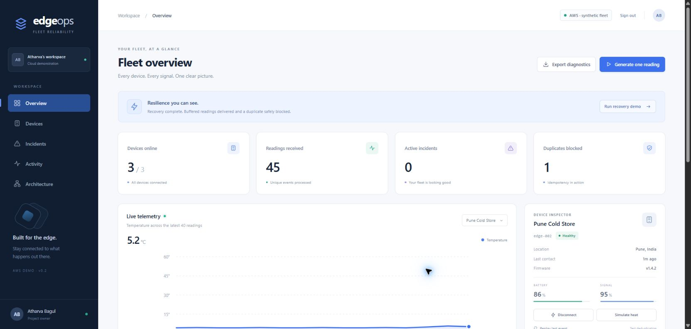
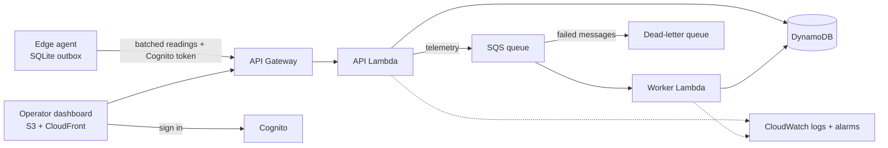
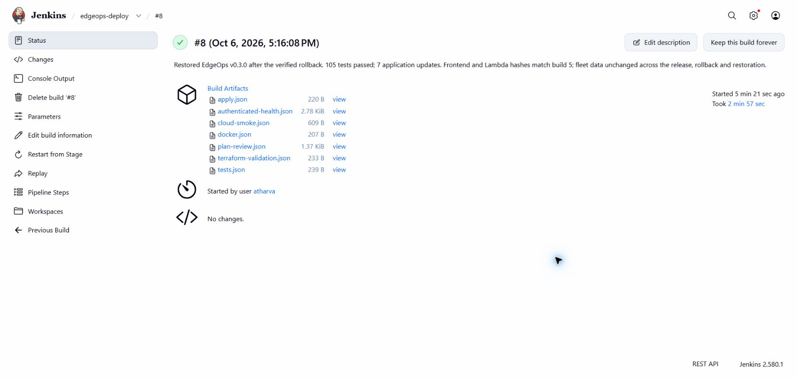

# EdgeOps

[](https://github.com/Atharvabagul84/edgeops/actions/workflows/ci.yml)
[](LICENSE)


**When an edge device loses its connection, its telemetry shouldn't be lost or counted twice.**

EdgeOps is a fleet-reliability demo. Devices buffer readings in a durable offline outbox, replay them after reconnecting, and the backend suppresses duplicates idempotently. Operators see incidents and recovery evidence on a dashboard. It runs locally with zero dependencies, and is deployed on AWS serverless with Terraform and a guarded Jenkins release/rollback pipeline.



**Live demo:** [d3aum9pitkz6he.cloudfront.net](https://d3aum9pitkz6he.cloudfront.net). Sign-in uses admin-created Cognito accounts (public signup is disabled), so the screenshots here show what's behind it. The fleet is synthetic; the authentication, queueing, persistence, deployment and CI are real.

## What this proves

- **Delivery guarantees:** monotonic per-device sequences, idempotent ingestion, acknowledgement-based replay and duplicate suppression, tested over real HTTP after simulated network loss.
- **AWS serverless on Terraform:** private S3 + CloudFront, Cognito, API Gateway, two Lambda functions, SQS with a dead-letter queue, DynamoDB and CloudWatch alarms. 51 resources, with locked provider versions.
- **Safe releases:** a Jenkins pipeline that can only update existing Lambda code and frontend objects. Resource creation, deletion and permission changes are rejected at plan review. A recorded release → rollback → restore rehearsal verified deployed artifact hashes, and fleet data stayed unchanged.
- **Testing discipline:** 105 tests across the backend, frontend and AWS adapter, run on every pull request by GitHub Actions, plus Terraform validation and a container health check.

## Architecture



Locally, the same domain logic runs behind a Python standard-library HTTP server with SQLite, so the whole app works offline. Domain code is separate from HTTP and persistence, which lets the AWS adapter reuse it unchanged.

## Run it locally

Needs Python 3.11+ and nothing else: no pip install, no API key, no cloud account.

```sh
python3 -m backend.server --port 8765 --data data/edgeops.sqlite3   # then open http://127.0.0.1:8765
```

On Windows you can double-click `start.cmd`. In the dashboard, click **Run recovery demo** to disconnect a device, buffer readings, reconnect and watch duplicates get suppressed.

To try the standalone edge agent's durable outbox:

```sh
python scripts/device_agent.py --offline --count 5   # buffer 5 readings with no network
python scripts/device_agent.py --flush-only          # deliver, removing only acknowledged batches
python scripts/device_agent.py --replay-last         # resend: the duplicate counter rises, state doesn't
```

More scenarios (heat incidents, diagnostics export, network-failure recovery, Docker) are in the [local demo guide](docs/guides/local-demo.md).

## Release pipeline

| Stage | What it does |
|---|---|
| Tests | Backend, frontend and AWS adapter suites, plus pipeline guard tests |
| Docker | Builds the non-root image and checks loopback health |
| Validate | Confirms the AWS target and validates Terraform |
| Plan review | Saves a plan and rejects anything except code-only updates |
| Apply | Applies the reviewed saved plan (only with `DEPLOY_AWS` approved) |
| Smoke | Read-only cloud checks, authenticated health and artifact hash verification |

Builds #5, #6 and #8 released 0.3.0, rolled back to the original artifacts, and restored 0.3.0 (177.5 s, 105 tests). Evidence: [build summaries](reports/pipeline), [rehearsal record](docs/evidence/release-rehearsal.json), [CI pipeline notes](docs/reference/ci-pipeline.md).



Jenkins ran on the author's machine, so its UI isn't public. Every pull request is checked publicly by [GitHub Actions](.github/workflows/ci.yml) instead.

## Tests

```sh
python3 -m unittest discover -s tests -v        # backend and edge agent
node --test frontend/tests/*.test.mjs           # frontend (Node 20+)
python3 -m unittest discover -s infra/tests -v  # AWS adapter
```

## Documentation

Start at the [documentation index](docs/README.md): [local demo](docs/guides/local-demo.md) · [AWS deployment](docs/guides/aws-deployment.md) · [runbook](docs/reference/runbook.md) · [CI pipeline](docs/reference/ci-pipeline.md) · [validation record](docs/reference/validation.md) · [design decisions](docs/decisions/).

## Contributing and security

See [CONTRIBUTING.md](CONTRIBUTING.md) for setup, checks and the pull-request flow, and [SECURITY.md](SECURITY.md) to report a vulnerability. Changes are listed in the [changelog](CHANGELOG.md).

## Limitations

A single shared synthetic fleet of three devices; no multi-tenancy, MFA or production uptime claim. Disconnects are simulator-driven, not detected from missing heartbeats. See [deliberate MVP limits](docs/reference/limitations.md) and the [validation record](docs/reference/validation.md) for what was verified live versus locally.

## License

[MIT](LICENSE) © 2026 Atharva Bagul
